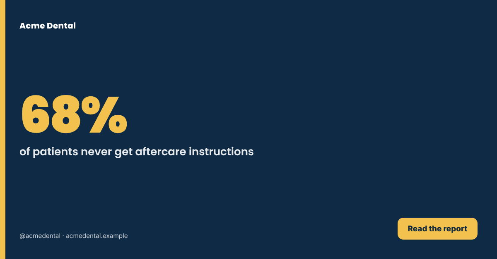

# Social Media Planner: Prometheus 🔥

Five Claude Code skills that work together. **One call** (`/prometheus`) researches your market,
out-posts your competitors, weighs the data, adds ideas nobody else has, and produces a
**7-day, platform-native content plan** for **LinkedIn, Facebook Page, Instagram, TikTok, X, Bluesky,
YouTube and Telegram Channel**. The plan comes with on-brand posters, generator-ready video specs,
and a **scheduled daily 24-hour-trend drop**.

```
           ┌──────────────────────┐
 brief ───▶│ 1 Researcher         │── research.json ─┬───────────────┐
           └──────────────────────┘                  │               │ (graveyard only)
           ┌──────────────────────┐                  ▼               ▼
           │ 2 Undying (2× rule)  │◀── research ┌──────────┐   ┌──────────────┐
           └──────────┬───────────┘             │3 Suggester│   │ 4 Outlier    │
                      └── undying.json ────────▶│ (model)  │   │ (no data)    │
                                                └────┬─────┘   └──────┬───────┘
                                                     ▼                ▼
                         brand/ ───────────▶ ┌──────────────────────────────┐
                                             │ 5 Planner (decides)          │
                                             │ weekly plan · posters ·      │
                                             │ video specs · daily schedule │
                                             └──────────────────────────────┘
```

## The five skills

| Skill | Role | Works alone? |
|---|---|---|
| **[Researcher Prometheus](.claude/skills/researcher-prometheus/SKILL.md)** | Maps every competitor (direct, partial, platforms, software, institutions, creators; local and international), their posting frequency and engagement, user conversations, pain points (solved, unsolved, ignored), trends, hashtags, regulation, AI impact, and one sharp persona with where to reach them | ✅ |
| **[The Undying Prometheus](.claude/skills/undying-prometheus/SKILL.md)** | The Doubling Law: at least **2× the most active competitor's** volume on every platform, spread across surfaces so the volume can't be ignored and doesn't trigger penalties. Includes a daily engagement quota and share-of-voice map | ✅ |
| **[Suggester Prometheus](.claude/skills/suggester-prometheus/SKILL.md)** | Weighted scoring model with a Monte Carlo robustness check. Ranks pain points and trends, magnifies the major pain points, sets pillar weights, and allocates posts per pillar per platform | ✅ |
| **[Outlier Prometheus](.claude/skills/outlier-prometheus/SKILL.md)** | Ignores data and trends. Builds a graveyard of generic ideas, digs to the need beneath the want, runs 18 thinking engines, kills anything a typical AI would suggest, and makes the decision nobody else is making | ✅ |
| **[Planner Prometheus](.claude/skills/planner-prometheus/SKILL.md)** | Head of content. Decides, writes every post natively per platform (checking new platform features each run), renders on-brand posters, writes video specs detailed enough for any generator, and sets up the daily schedule | ✅ (fills gaps itself) |

Each skill folder is **self-contained**, so you can copy any of them into another project or repo.

## Quick start

1. **Get Claude Code**: see https://code.claude.com.
2. **Clone the repo and configure it:**
   ```bash
   git clone https://github.com/NdireS/Social-Media-Planner-Prometheus.git
   ```
   ```bash
   cd Social-Media-Planner-Prometheus && cp prometheus.config.example.yaml prometheus.config.yaml
   ```
   Edit `prometheus.config.yaml` with your business, service, market and timezone.
3. **Add your brand** to `brand/`: a logo, `brand.json` (copy `brand.example.json`), guidelines and photos. This step is optional, but it makes the output much better.
4. **Run it:**
   ```bash
   claude "/prometheus"
   ```
   Or pass a brief directly: `claude "/prometheus Acme Dental, Nairobi, teeth whitening"`.
5. **Daily drop:** `claude "/prometheus-daily"`, or let the schedule run it.

## Installing the skills (the `/` menu)

There are **7 slash skills**: `/prometheus`, `/prometheus-daily`, `/researcher-prometheus`,
`/undying-prometheus`, `/suggester-prometheus`, `/outlier-prometheus` and `/planner-prometheus`.

> **Why can't I see them?** Claude Code only loads `.claude/skills` from the folder you **open** it in.
> If you open a parent folder (for example a repo that *contains* this one as a subfolder), they won't show.
> Either open this folder directly, or install the skills globally with one of the options below.

**Option A: open this folder.** Run `cd Social-Media-Planner-Prometheus` and then `claude`. All 7 appear when you type `/`.

**Option B: install for every project, each skill on its own if you like.**
```bash
bash scripts/install-skills.sh
```
Only some skills (installing `prometheus` also installs the five building blocks it needs):
```bash
bash scripts/install-skills.sh researcher undying outlier
```
Into another repo instead of your user folder:
```bash
bash scripts/install-skills.sh --project ~/code/other-repo suggester
```
Windows (PowerShell):
```powershell
powershell -ExecutionPolicy Bypass -File scripts\install-skills.ps1 researcher outlier
```
The skills are copied to `~/.claude/skills/`. Restart Claude Code, then type `/`. Remove them with `--uninstall`.

**Option C: install as a plugin.** In Claude Code:
```
/plugin marketplace add NdireS/Social-Media-Planner-Prometheus
/plugin install social-media-planner-prometheus@prometheus
```
Plugin skills are namespaced, for example `/social-media-planner-prometheus:prometheus`.

**Claude.ai or the Desktop app (Skills upload):** zip a single skill folder (for example
`.claude/skills/researcher-prometheus/`) and upload it under Settings → Capabilities → Skills.

## What you get

```
output/acme-dental/2026-11-09/
├── 01-research.md  research.json  sources.md
├── 02-undying.md   undying.json
├── 03-suggester.md suggester.json
├── 04-outlier.md   04-outlier-workings.md  outlier.json
├── 05-weekly-plan.md  weekly-plan.json  weekly-plan.csv
├── assets/posters.json  assets/posters/*.png  assets/image-prompts.md
├── videos/<id>.md  videos/<id>.json          # shot lists, transcripts, AI prompts
└── engagement-quota.md
output/acme-dental/daily/2026-11-10/daily-plan.md …
```

Example posters rendered by the brand engine (from the synthetic sample brand):

<p>



</p>

## Scheduling the daily run

The Planner sets this up at the end of each weekly run, using whichever of these is available:

1. **GitHub Actions** (included): `.github/workflows/prometheus-daily.yml` (every day) and `prometheus-weekly.yml` (Sundays).
   Add the repository secret `ANTHROPIC_API_KEY` (or `CLAUDE_CODE_OAUTH_TOKEN`), commit your `prometheus.config.yaml`,
   and edit the cron lines to your timezone (cron runs in UTC). Outputs are committed back to `output/`.
2. **Local cron:** `bash scripts/schedule-local.sh` (remove with `--remove`).
3. **In-session schedulers**: if your Claude environment provides a scheduled-task tool, the Planner uses it.

## Deterministic engines (no API needed)

| Script | What it does |
|---|---|
| `.claude/skills/undying-prometheus/scripts/cadence.py` | Doubling Law: benchmarks, targets, surface mix, share of voice |
| `.claude/skills/suggester-prometheus/scripts/score.py` | Scoring model, robustness, pillar weights, allocation; `--validate` checks research.json |
| `.claude/skills/planner-prometheus/scripts/render_posters.py` | Brand tokens + poster specs → PNG (Playwright or Chrome) |
| `.claude/skills/planner-prometheus/scripts/plan_to_csv.py` | Plan JSON → CSV for schedulers (Buffer, Postiz, Hootsuite, Later) |

Run `bash scripts/selftest.sh` to test all of them against the synthetic sample data in `examples/`.

## Notes
- Research uses live web search. Some platforms block scraping, so numbers are labelled `measured`, `reported` or `estimated`.
- Nothing is ever published to social platforms without your confirmation.
- Platform specs change. The Planner re-checks the latest features on every weekly run, and `.claude/skills/planner-prometheus/references/platform-playbook.md` holds the baseline.

MIT licensed.
